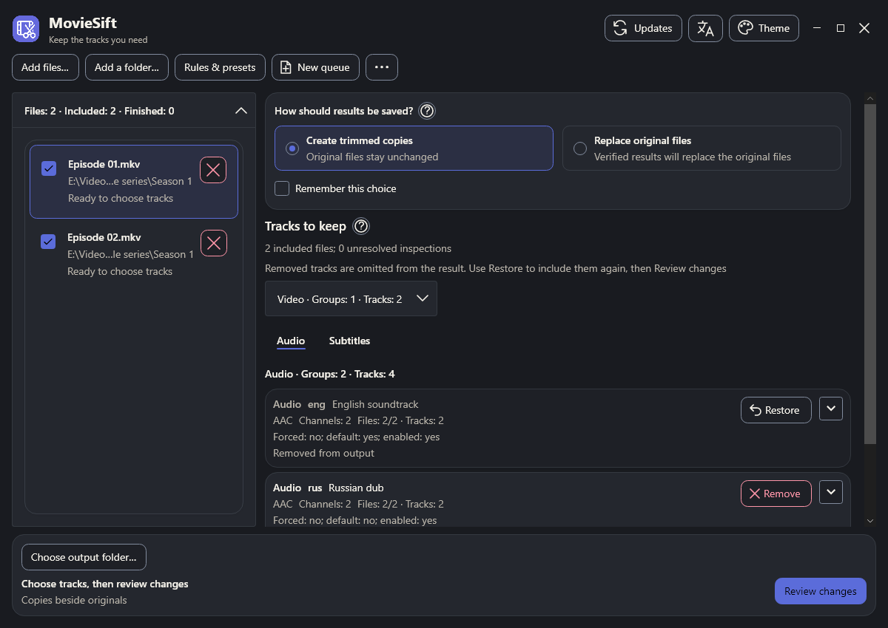

# MovieSift

Keep the tracks you need

Remove unwanted audio and subtitle tracks from MKV and supported MP4 files without re-encoding

**[Download for Windows or Linux](https://github.com/Nexusov/MovieSift/releases/latest)**

## Get started

1. Extract the portable archive and run `MovieSift.exe` on Windows or `./MovieSift` on Linux
2. Add a movie, several files or a series folder
3. Switch between **Audio** and **Subtitles**, then **Remove** unwanted tracks; muted cards offer **Restore**
4. Choose how to save the result, review the changes and start processing

**Create trimmed copies** preserves the originals. **Replace original files** is a separate, explicit choice and still requires verification and Review

The .NET runtime and media tools are included. Keep the complete extracted folder together: the launcher is at the root, internal files are in `app`, and portable preferences are in `data`

## Features

- Independent choices for one movie or a sequential mixed MKV/MP4 queue
- Optional recursive folders with preserved season/subfolder output paths
- Language, literal-title and forced-subtitle rules with explicit Preview and Apply
- Named portable rule presets and explicit restoration of unfinished lists
- Light/dark themes, custom colors and 15 interface languages; English is included, other translations download on demand
- Update checks at startup and a dedicated **Updates** button for manual checks

MKV and MP4 have explicit preservation limits. MP4 support covers the documented H.264/AAC/mov_text subset; neither format is converted into the other. See [supported formats and platforms](docs/SUPPORTED_FORMATS.md), including Linux system-library requirements

## Documentation

- [Usage, portable settings and upgrades](docs/USAGE.md)
- [Build and contribute](CONTRIBUTING.md)
- [Architecture](docs/ARCHITECTURE.md)

## License

[MIT](LICENSE) · [Third-party licenses and notices](THIRD_PARTY_NOTICES.md)
