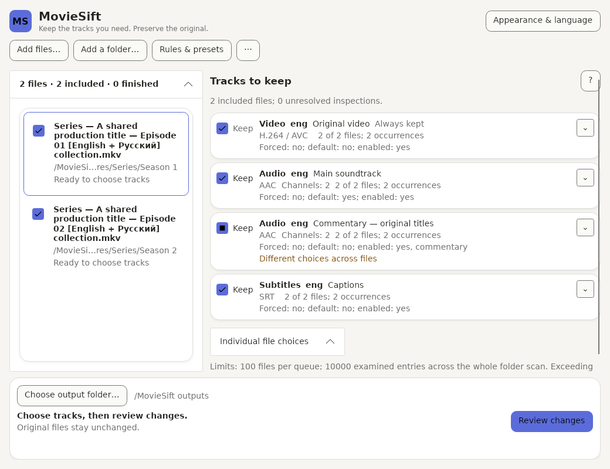

# MovieSift

MovieSift removes unwanted embedded audio and subtitle tracks from local **MKV and supported MP4** files without re-encoding. It creates a separate `.trimmed.mkv` or `.trimmed.mp4` copy and leaves the original untouched. Keeping both files does not free the original's disk space.

[**MovieSift 0.1.0-rc.1**](https://github.com/Nexusov/MovieSift/releases/tag/v0.1.0-rc.1) is the first public **Pre-release**, for evaluation rather than a fully accepted stable release. Its frozen binary source is `a0ea505a6275f3b89e7b08ac4e6a7ae058c6ca5a`.

**Portable downloads:** [Windows x64 ZIP](https://github.com/Nexusov/MovieSift/releases/download/v0.1.0-rc.1/MovieSift-win-x64.zip) · [Linux x64 tar.gz](https://github.com/Nexusov/MovieSift/releases/download/v0.1.0-rc.1/MovieSift-linux-x64.tar.gz). Extract the complete archive into a new writable folder, then launch `MovieSift.exe` on Windows or `./MovieSift` on Linux. No separately installed .NET or media tools are required; Linux still needs the documented [OS native libraries](docs/SUPPORTED_FORMATS.md#platform-and-native-requirements).

[Windows matching materials](https://github.com/Nexusov/MovieSift/releases/download/v0.1.0-rc.1/MovieSift-win-x64-materials-a0ea505a6275.tar.gz), [Linux matching materials](https://github.com/Nexusov/MovieSift/releases/download/v0.1.0-rc.1/MovieSift-linux-x64-materials-a0ea505a6275.tar.gz), inventories, summaries and [SHA256SUMS](https://github.com/Nexusov/MovieSift/releases/download/v0.1.0-rc.1/SHA256SUMS) accompany the binaries. Current automated checks do not establish clean Windows 11 or Ubuntu Desktop, native visual/scaling or the recorded cancellation/close/warning acceptance gaps. See the [release checklist](docs/release-checklist.md).

## Remove tracks

1. **Add files** or **Add folder**. One file and a series use the same workspace. Choose an output folder for changed files. Optional **Include subfolders** preserves season-relative paths under an explicitly selected output root.
2. Inspect the **Audio** and **Subtitles** sections. Each group shows file coverage and every concrete occurrence, including duplicates and a language found in only one episode. **Checked means retained; unchecked means omitted from the new copy.** All admitted video stays retained.
3. Uncheck unwanted groups or individual occurrences. **Remove all subtitles from copies** clears all included editable subtitle choices in one reversible action, including unknown-language tracks. It leaves audio, video, attachments, excluded files and completed results alone. Advanced language/title/forced rules are optional: explicitly Preview, then Apply; presets load only through **Load**.
4. **Review changes**. Each source gets its own immutable plan using its actual tracks. Confirm zero audio separately for any affected file. Resolve or exclude failed inputs. A genuine **NoChange** item creates no output and does not require a usable destination; its source is still rechecked and protected against another file's changed output.
5. Use the separate **Create N copies** action. Jobs run sequentially, verify the admitted retained content and publish without overwriting. Review, rule edits and theme/language changes never start processing.



This is an actual Avalonia.Headless/Skia render, not native desktop or OS-scaling evidence. The [Russian view](docs/images/moviesift-ru.png) uses the same controls and selections.

## Working with a queue

- **Pause after current file** finishes that job; **Cancel batch** requests cancellation of the owned job and prevents the next item starting. Warning, failure and uncertain cleanup pause dispatch. Previously published outputs remain intact.
- Resolve a retained MKV warning through its explicit publish/discard action. Failed verification and FFmpeg errors cannot be overridden. Close waits for the existing owner; an uncertain worker or publication is never treated as a successful cleanup.
- **New queue** clears a safe in-memory list after confirmation, preserving media, outputs, preferences, presets and rule configuration. It requires fresh inspection/Review for later work.
- After restart, explicitly **Restore saved list** or **Discard saved list**. Restore recovers unfinished paths and destination intent, never old inspections, track indexes, approvals or execution authority. Freshly inspect and Review before Run. Discard does not delete media or ownership records. Corrupt records remain visible and untouched; correct them externally and use **Reload saved list** with an empty queue. See [recovery behavior](docs/ARCHITECTURE.md#unfinished-queue-list-recovery).

## Supported scope and limits

MKV uses pinned MKVToolNix. MP4 uses pinned FFmpeg/ffprobe and admits ordinary self-contained, unencrypted, nonfragmented **H.264/AVC, AAC and mov_text**, supported ordinary chapters and JPEG/PNG artwork. At most one distinct referenced QuickTime chapter track is admitted; multiple references to that same track are allowed. The [preservation matrix](docs/SUPPORTED_FORMATS.md) states exact metadata, timing, verification, rejected features and inspection limits. This is not a universal container-preservation tool.

Discovery supports at most **100 session entries**, **10,000 examined filesystem entries** per complete scan and depth **32**. It rejects network filesystems and redirected directories rather than following symlinks/junctions. Failed/limited/cancelled discovery accepts no partial subset; cancellation during later inspection retains already accepted rows. Existing outputs, source aliases and changed-output collisions are errors, with no automatic renaming. Empty prepared nested directories may remain after failure/cancellation; owned media candidates/journals follow the normal cleanup rules.

English is the first-launch language. **Appearance & language** provides live English/Russian, theme, accessible custom colors and reduced motion. User titles, paths and preset names remain original. A language/appearance preference save failure is session-only and does not independently block media; unavailable required data/ownership storage still blocks writes. Appearance closes with Escape and returns keyboard focus without cancelling media.

There is no container conversion, transcoding, playback, source replacement, parallel remux, automatic restart execution, preset update/import/export, title-only rule or regex. [Exact rule semantics](docs/SUPPORTED_FORMATS.md#language-selection-rules), [portable presets](docs/ARCHITECTURE.md#phase-2c1-portable-rule-presets) and [architecture](docs/ARCHITECTURE.md) document the advanced behavior.

## Upgrading an earlier portable candidate

Extract MovieSift into a **new directory**. Finish or explicitly discard pending work in the previous candidate and close it before moving preferences. `data/settings.json`, `appearance.json` and `rule-presets.json` can be carried over; restoring a copied `queue-list.json` still requires fresh inspection and Review.

Keep the previous copy for unresolved ownership. Do not copy unresolved `data/ownership`, rename private job directories or edit journal paths: a different layout cannot authorize cleanup. MovieSift's custom FFmpeg version label requires matching rebuilt workers; old worker binaries fail the exact version check. Historical candidates and their evidence remain unchanged.

## Developers

Use the SDK pinned in `global.json`. Source-only checks are:

```powershell
dotnet restore --locked-mode
dotnet format --verify-no-changes --no-restore
dotnet build --configuration Release --no-restore
dotnet test --configuration Release --no-build --no-restore
```

Without the pinned media workers/fixtures these are ordinary checks with explicit media skips, **not mandatory media coverage**. Follow the complete [Windows](CONTRIBUTING.md#windows-media-setup) or [Linux](CONTRIBUTING.md#linux-media-setup) setup before required tests, running the GUI or packaging. Windows requires the verified source-built MKV worker/material artifact and either the exact validated FFmpeg build cache or its documented native build prerequisites; a bare acquisition command is insufficient.

Both required CI jobs run locked restore, formatting, Release build, mandatory real-media/headless tests, inventory, actual MKV/MP4 package and relocation checks; Linux also executes the clean no-SDK/no-external-media/no-network container workflow. Headless, controlled-process, real-media and native desktop evidence are distinct. [Current verification](docs/PLAN.md) and the [historical evidence index](docs/verification/README.md) preserve those boundaries.

Portable targets are self-contained `MovieSift-win-x64.zip` and `MovieSift-linux-x64.tar.gz`, without an application installer or user-installed .NET/media tools. Declared desktop targets remain **Windows 11 x64 25H2** and **Ubuntu 24.04 x64 Desktop/X11-XWayland**; see [native requirements](docs/SUPPORTED_FORMATS.md#platform-and-native-requirements). Windows 10 observations, hosted runners and Linux container checks retain their actual scope.

Original MovieSift code is [MIT](LICENSE), copyright (c) 2026 Nexusov. Bundled components retain their own [notices](THIRD_PARTY_NOTICES.md) and [distribution requirements](docs/verification/release-distribution-closure.md). This RC publishes its exact matching source/build materials alongside the binaries. Deferred desktop acceptance remains recorded; a stable release requires its own final review. No running-application downloads, telemetry or auto-updates are introduced.
