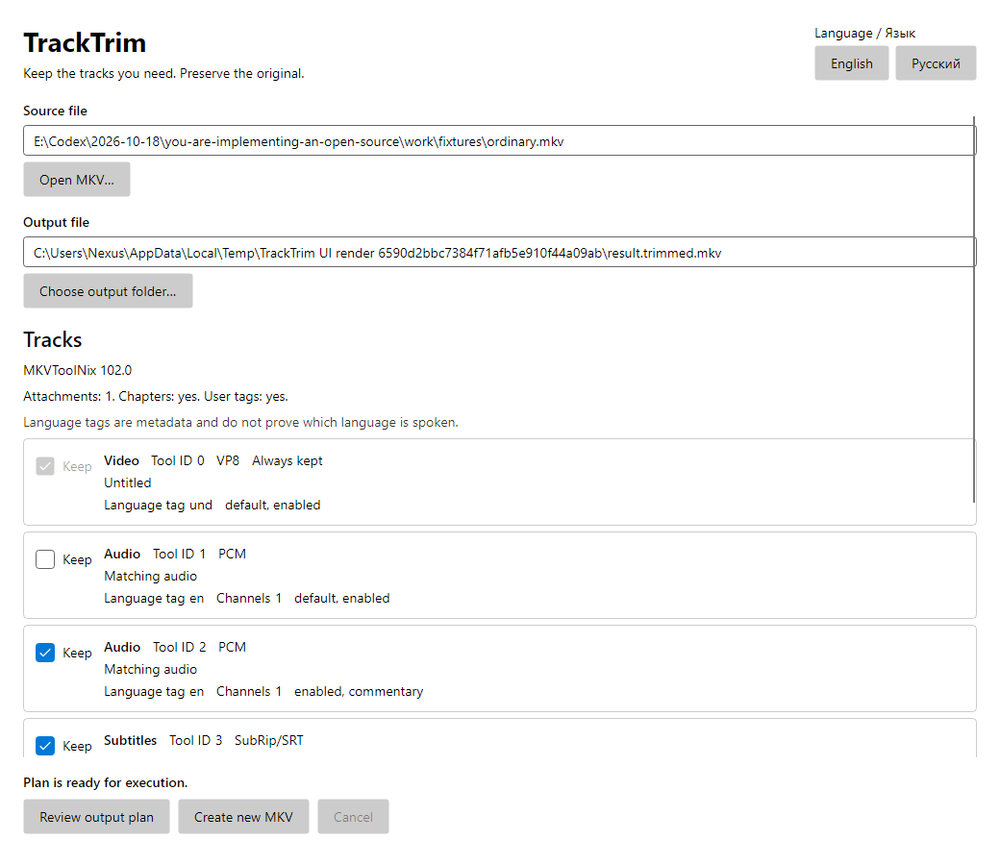
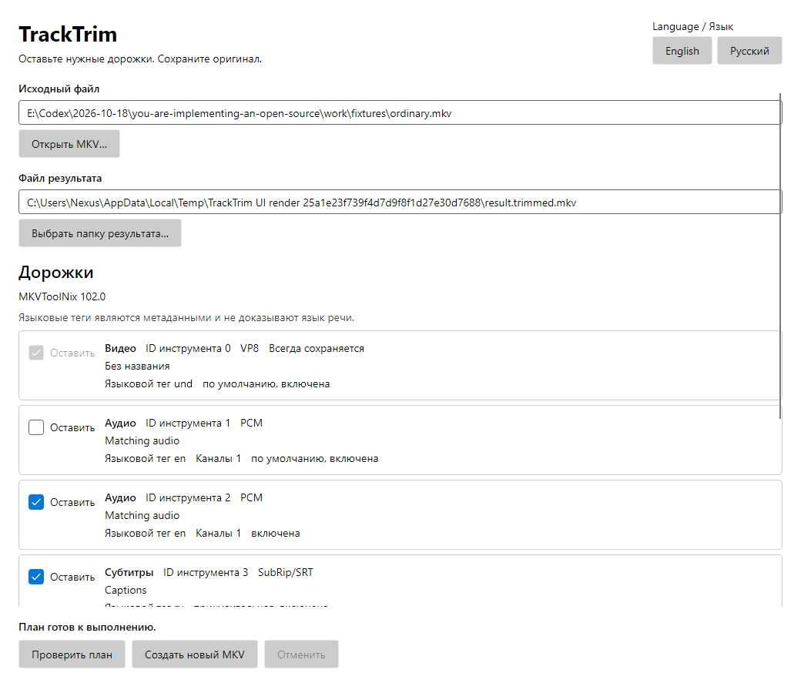

# TrackTrim

TrackTrim is a portable Windows/Linux desktop application for removing selected embedded audio and subtitle tracks from one local MKV without re-encoding. It writes a separate MKV; the original remains on disk. Removing tracks from a second file does not free the original's space.

This branch implements the Phase 0 foundation and Phase 1 workflow. It is a review build, not a public release. [Acceptance status and executed checks](docs/PLAN.md) distinguish implemented code from verified behavior and outstanding platform requirements. CI builds and tests archives but uploads only test/provenance evidence while binary redistribution obligations remain unresolved.

The application uses C#/.NET 10, Avalonia 12 with Fluent controls, CommunityToolkit.Mvvm, and pinned MKVToolNix executables. English is the initial language, including on a Russian OS. The English / Русский selector changes application text without discarding the current selection; the choice is saved beside the application.

## Current workflow

1. Open one MKV with the native file picker and inspect its real tracks.
2. Leave **Keep** checked for each audio/subtitle track to retain. Every video track and supported attachment is retained.
3. Select a separate destination and review the immutable plan. Confirm removal of all audio explicitly when applicable.
4. Run the remux, observe measured backend progress, or cancel. A no-change plan does not remux.
5. The application verifies the candidate before publishing through a no-overwrite move. Warnings require a separate publish/discard decision after successful verification. Closing during warning review offers **remain in review** or **discard and close**; the latter waits for cleanup.

Do not use the application as a universal preservation tool. The [supported MKV matrix](docs/SUPPORTED_FORMATS.md) defines the inspected, verified, and rejected cases. MP4, batch input, folders, presets, playback, source replacement, and recovery/resume of a batch queue are outside this implementation.

Preflight supplements MKVToolNix identification with bounded, read-only Segment Info inspection. Detected segment families and previous/next links are rejected before processing; layouts that cannot be inspected within those bounds fail explicitly. This check uses no additional media executable.

These are headless renders of the compiled Fluent view after real MKV inspection, in English and Russian. Native desktop acceptance remains pending; the [current native attempt and manual handoff](docs/verification/native-desktop-acceptance.md) record the 2026-10-19 kernel reset/retry and log diagnosis, unchanged archive identity and unexecuted checks. Computer Use still fails before JavaScript; no native GUI action has reached TrackTrim.





## Build and run

Install the exact stable SDK in `global.json`, PowerShell 7, and Python 3 for the build scripts (Python 3.9+ with standard-library `tarfile`/XZ support; the local verification used Python 3.13.0). Python extracts pinned source notices and generates original fixtures; it is not an application runtime dependency. No media tools are downloaded by the running application. Acquisition is an explicit developer/build operation:

```powershell
pwsh ./build/acquire-tools.ps1 -RuntimeIdentifier win-x64 -Destination ./tools
dotnet restore --locked-mode
dotnet build --configuration Release --no-restore
```

Use `linux-x64` on Linux. Place the acquired `tools` directory beside the built entry point before a development run. `TRACKTRIM_TOOL_DIRECTORY` is a test setting; the desktop application always uses its app-local bundle. A portable package supplies this layout automatically.

```powershell
Copy-Item -LiteralPath ./tools -Destination ./src/TrackTrim.Desktop/bin/Release/net10.0 -Recurse
dotnet run --project src/TrackTrim.Desktop --configuration Release --no-build
dotnet format --verify-no-changes --no-restore
dotnet test --configuration Release --no-build --no-restore
```

See [CONTRIBUTING](CONTRIBUTING.md) for mandatory real-media checks and [fixture provenance](tests/TrackTrim.Infrastructure.Tests/Fixtures/README.md) for the generated VP8/PCM/SRT and checked-in direct FFmpeg-origin H264/AAC/SRT samples. FFmpeg is a development-only fixture encoder, excluded from the application and portable archives. Unit tests and headless UI tests do not replace a real desktop or a packaged workflow.

## Portable archives

```powershell
pwsh ./build/package.ps1 -RuntimeIdentifier win-x64
pwsh ./build/package.ps1 -RuntimeIdentifier linux-x64
```

Run each command on its target OS. The outputs are `artifacts/TrackTrim-win-x64.zip` and `artifacts/TrackTrim-linux-x64.tar.gz`. Each contains the complete self-contained runtime, tool dependency closure, license inventory, provenance, and an empty app-local `data` directory. Publishing is untrimmed, with no AOT or single-file optimization. Runtime security updates require rebuilding the archives.

Linux packaging extracts a pinned upstream MKVToolNix AppImage **at build time**. The application launches its extracted native CLI executables directly, with an app-relative library path in the child environment; it does not run media through a shell. Build-time acquisition/fixture helpers may use fixed wrappers. No FUSE, extraction, or download is required at first launch. Native dependency checks must pass during packaging; this is not a guarantee for arbitrary Linux distributions.

Proposed acceptance targets are Windows 11 x64 25H2 and Ubuntu 24.04 x64 Desktop using X11/XWayland. Exact tested hosts and unverified desktop checks are recorded in [PLAN](docs/PLAN.md). See [native requirements](docs/SUPPORTED_FORMATS.md#platform-and-native-requirements) before making a compatibility claim.

To test a relocated archive, provide a generated multi-track fixture:

```powershell
pwsh ./build/verify-package.ps1 -ArchivePath ./artifacts/TrackTrim-win-x64.zip -FixturePath ./artifacts/fixtures/ordinary.mkv
```

This runs the actual packaged entry point from an unrelated working directory, tests a path containing spaces/Cyrillic/metacharacters, performs the real application workflow, and hashes the source before/after. It does not establish native dialogs, scaling, or clean-machine desktop acceptance.

Linux CI also verifies the actual workflow in a pinned Ubuntu 24.04 container with native OS libraries, no installed SDK/runtime/media commands, no network, and a non-root runtime user. Run it with `bash ./build/verify-clean-linux.sh ./artifacts/TrackTrim-linux-x64.tar.gz ./artifacts/fixtures/ordinary.mkv`. The successful check records the exact base image, installed package versions, user, and ASCII parent locale (`C`); the native worker boundary handles Cyrillic paths independently. See [PLAN](docs/PLAN.md) for executed evidence; a container CLI check is separate from Ubuntu Desktop acceptance.

Settings, bounded logs, and temporary-output ownership records are stored in `data` relative to the executable. An unwritable data directory is an error for media writes; the application must not silently redirect to a user profile. Startup recovery offers validated owned-temporary cleanup, never automatic publication or byte resume. Malformed, incomplete or nonregular records remain visible for manual review; they cannot authorize cleanup, and their original files remain untouched.

## Licensing

The original application license has not been selected. Bundled components retain their own licenses; [THIRD_PARTY_NOTICES](THIRD_PARTY_NOTICES.md) records provenance and unresolved corresponding-source obligations. Calling an archive a review build does not exempt its redistribution from those obligations. CI does not upload binary archives, and no installer or release is published by this implementation.
